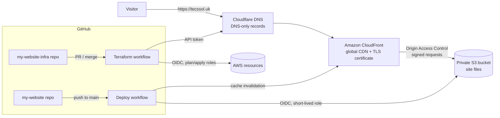

# tecssol.uk: Project Documentation

**Scope:** what was built across the two repositories, how they fit together, and how the site is operated.
**Status:** live at https://tecssol.uk and https://www.tecssol.uk

---

## 1. Summary

tecssol.uk hosts *TechResearch*, a static portfolio and technical blog (HTML, CSS and images). The site runs on AWS behind a global CDN, uses a Cloudflare-managed domain, and is deployed fully automatically from GitHub.

There are two repositories with separate responsibilities:

| Repository | Holds | Changes when |
|---|---|---|
| **my-website** | Site content (pages, blog posts, styles, images) and the *deploy* pipeline | You write or edit content |
| **my-website-infra** | Infrastructure as code (Terraform) and the *infrastructure* pipeline | The hosting, domain or permissions change |

No one logs in to AWS to publish content. No AWS passwords or access keys are stored in GitHub. Every infrastructure change is reviewed as a plan and approved before it is applied.

---

## 2. Architecture

**How a page request is served**
1. The browser looks up `tecssol.uk`. Cloudflare DNS answers with the CloudFront address.
2. CloudFront terminates HTTPS using an AWS-issued certificate for `tecssol.uk` and `www.tecssol.uk`.
3. If CloudFront has the page cached, it returns it from the nearest edge location. Otherwise it fetches the page from the private S3 bucket using a signed request. The bucket cannot be reached any other way.

---

## 3. Work done in `my-website` (content repository)

| Item | Description |
|---|---|
| Site content | `index.html`, `about.html`, `posts.html`, `blog/*.html`, `style.css`, `images/` |
| Deploy pipeline | `.github/workflows/deploy.yml`, which publishes the site on every push to `main` or on manual run |
| GitHub environment `production` | Created and configured **by Terraform**. Restricted to the `main` branch. Holds three non-secret variables. |

**What the deploy pipeline does**
1. Signs in to AWS through GitHub's OpenID Connect (OIDC) identity. It assumes a deploy role that allows only this repository's `production` environment.
2. Reads the bucket name and CloudFront distribution ID from AWS Systems Manager Parameter Store. Terraform writes these when it creates the infrastructure.
3. Synchronises the repository to the S3 bucket (`--delete` removes files that were deleted from the repo). Git metadata, workflow files and Markdown documents are excluded.
4. Invalidates the CloudFront cache so visitors see the new version immediately.

The repository contains **no secrets**. Its three environment variables (`AWS_ROLE_ARN`, `AWS_REGION`, `SITE_PARAMETER_PREFIX`) are written by Terraform.

---

## 4. Work done in `my-website-infra` (infrastructure repository)

### 4.1 Layout

| Folder | Purpose | Run by |
|---|---|---|
| `bootstrap/` | One-time foundation: Terraform state storage, GitHub trust in AWS, the CI roles, and GitHub environments and variables | An administrator, from an admin workstation (a GCP VM) |
| `modules/static-site/` | Reusable building block for a static site: bucket, CDN, certificate, DNS and deploy permissions | Used by each environment |
| `envs/prod/` | The production environment: its settings (domain, region) and where its state is stored | The Terraform pipeline |
| `.github/workflows/` | `terraform.yml` (triggers) and `terraform-env.yml` (reusable plan → approve → apply) | GitHub Actions |
| `docs/` | This documentation | — |

### 4.2 What the infrastructure consists of

**Foundation (bootstrap)**
- An encrypted, versioned, private S3 bucket for Terraform state, protected against deletion.
- A trust link between AWS and GitHub (OIDC identity provider), so GitHub workflows can obtain short-lived AWS credentials.
- Three IAM roles:
  - **tf-plan**: read-only; used for pull requests and the `main` branch.
  - **tf-apply**: can change the site's resources; usable only from the approval-gated `infra-prod` environment.
  - **prod-site-deploy**: usable only from the website repo's `production` environment.
- GitHub configuration:
  - the `infra-prod` environment (owner approval, `main` only) and four variables in the infra repository;
  - the `production` environment and three variables in the website repository.

**Production site (`envs/prod`)**
- A private S3 bucket for site files: encrypted, versioned, with old versions expiring after 30 days, and HTTPS-only.
- A CloudFront distribution:
  - HTTP/2 and HTTP/3, IPv6, compression;
  - AWS-managed security headers;
  - a small edge function so `/blog/` serves `/blog/index.html`.
- A public TLS certificate for `tecssol.uk` and `www.tecssol.uk`, validated automatically via DNS.
- Cloudflare DNS records: certificate validation, plus `tecssol.uk` and `www` pointing to CloudFront.
- Two Parameter Store entries (bucket name, distribution ID) for the website pipeline to read.
- The permissions attached to the deploy role, limited to this bucket, this distribution and those two parameters.

The full inventory, in plain language, is in **02-terraform-design-and-resources.md**.

### 4.3 Configuration lives in three small files

| File | Contains |
|---|---|
| `bootstrap/terraform.tfvars` | AWS region, project name, GitHub owner, the two repository names, and the environments with their GitHub environment names |
| `envs/prod/terraform.tfvars` | Project name, environment name, region, domain `tecssol.uk`, include `www` |
| `envs/prod/backend.hcl` | Where this environment's state is stored (path, encryption, locking) |

Account numbers and GitHub IDs never appear in code. Terraform looks them up at run time.

---

## 5. Security model

| Concern | How it is handled |
|---|---|
| AWS credentials in CI | None stored. GitHub workflows exchange a signed GitHub identity token for credentials that last one hour (OIDC). |
| Who can assume which role | Each role trusts one exact GitHub repository and context: PR/`main` for plan, the `infra-prod` environment for apply, the `production` environment for deploy. The trust includes GitHub's immutable account and repository IDs, so a deleted and re-created repository with the same name cannot use them. |
| Least privilege | Plan is read-only. Apply can manage only resources prefixed with the project name and cannot create IAM roles. Deploy can only write to one bucket and invalidate one distribution. |
| Change control | Infrastructure changes appear as a plan in the pipeline summary. Apply runs **that exact saved plan**, only after an approver accepts it. |
| Public access | The site bucket blocks all public access. Only this CloudFront distribution can read it. |
| Secrets | The only secrets are two Cloudflare API tokens: a read token for plans and an edit token for applies, held in the approval-gated environment. Both are scoped to the single DNS zone. |
| State protection | The state bucket is versioned, encrypted, HTTPS-only and protected from deletion. CI cannot change its settings. |

---

## 6. Operating the site

| Task | How |
|---|---|
| Publish or modify content | Commit to `my-website` → push to `main`. The site updates in about a minute. |
| Change infrastructure | Edit `my-website-infra` in a branch → open a PR → read the plan in the job summary → merge → approve the `infra-prod` deployment. |
| Re-run a deploy | GitHub → Actions → *Deploy site* → **Run workflow**. |
| Add an environment (e.g. dev) | Six steps: (1) add it to the bootstrap environments and apply on the admin VM; (2) copy `envs/prod` to `envs/dev`, set its domain and state key, and pass the Cloudflare zone name for subdomains; (3) add a job to `terraform.yml`; (4) add the Cloudflare edit token to `infra-dev`; (5) PR → merge → approve; (6) add a website deploy workflow for the `develop` branch. Full walkthrough: **05-making-infrastructure-changes.md, section 6**. |
| Roll back content | Revert the commit and push. The bucket also keeps 30 days of previous file versions. |
| Change foundation or permissions | Edit `bootstrap/`, then run `terraform plan` / `apply` from the admin workstation. CI never runs bootstrap. |

The full process for infrastructure changes (where each kind of change goes, adding new AWS services, adding environments, and what to avoid) is in **05-making-infrastructure-changes.md**.

> Pushes that change only `docs/` or `bootstrap/` do not start the Terraform pipeline. This is by design.

---

## 7. One-time setup that was performed manually

These steps are intentionally manual: they create the first credentials, or they handle values that are secrets.

1. Prepared an admin workstation (GCP VM) with Terraform, AWS CLI v2 and Git, and signed in to AWS with administrator access.
2. Created a GitHub fine-grained token (repository administration, environments and variables) for bootstrap.
3. Created two Cloudflare API tokens limited to the `tecssol.uk` zone: one for DNS read, one for DNS edit.
4. Removed existing `tecssol.uk` / `www` address records in Cloudflare, so Terraform could own them.
5. Ran `terraform apply` in `bootstrap/`.
6. Stored the Cloudflare tokens as GitHub secrets: the read token as a repository secret, the edit token in the `infra-prod` environment.
7. Ran the Terraform pipeline and approved the apply. Pushed the website repository to publish.

Everything else, including the GitHub environments, variables and DNS records, was created by Terraform.

---

## 8. Technology summary

| Area | Technology |
|---|---|
| Hosting | Amazon S3 (private) + Amazon CloudFront |
| TLS | AWS Certificate Manager (us-east-1, DNS-validated) |
| DNS / registrar | Cloudflare |
| Infrastructure as code | Terraform ≥ 1.10 with AWS, Cloudflare and GitHub providers |
| State | S3 backend with native lock files |
| CI/CD | GitHub Actions with reusable workflows and environments |
| Identity | GitHub OIDC → AWS IAM role federation |
| Configuration hand-off | AWS Systems Manager Parameter Store |
| Admin workstation | Google Cloud VM |

## 9. Related documents

- **02-terraform-design-and-resources.md**: how the Terraform is designed and what it created, in plain language.
- **03-technical-deep-dive.md**: GitHub Actions, Terraform, and how the providers work.
- **04-case-study.md**: the project as a case study.
- **05-making-infrastructure-changes.md**: step-by-step guide for changing the infrastructure.
