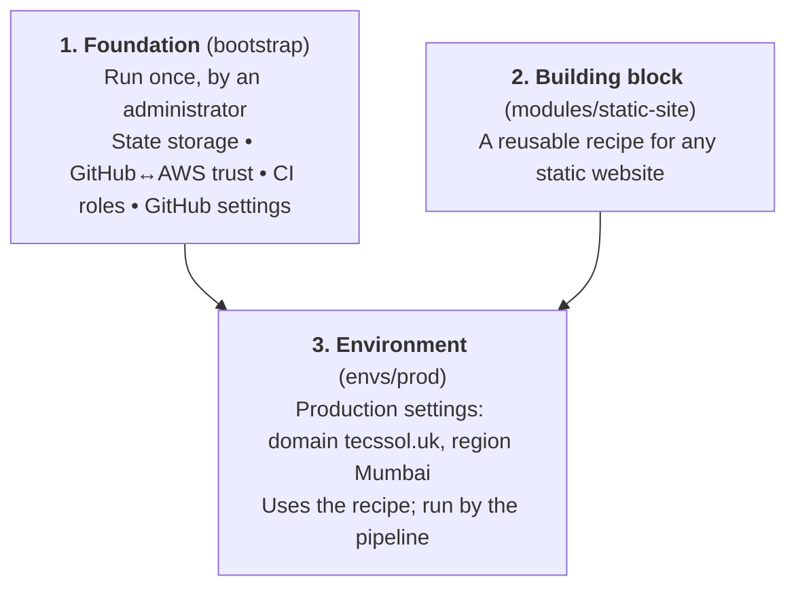
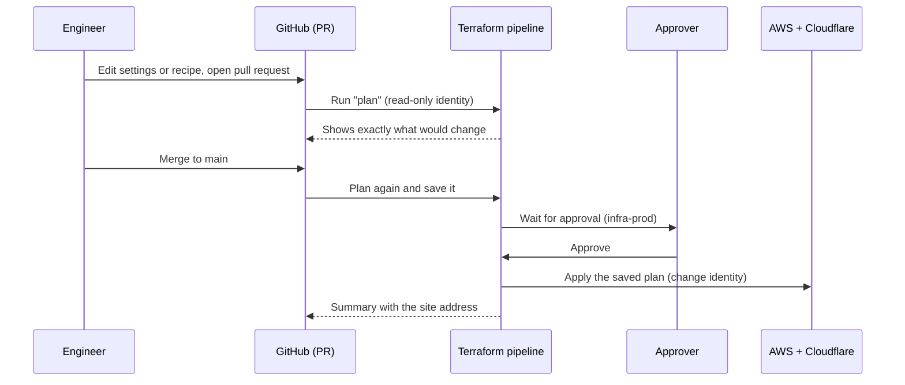

# How the Infrastructure Is Designed, and What It Created

*Written for technical and non-technical readers. No code knowledge needed.*

---

## 1. What Terraform is, in one paragraph

Terraform is a tool that builds infrastructure from a written description. Instead of clicking through the AWS, Cloudflare and GitHub websites to create things, we write down *what should exist*: "a private storage bucket", "a DNS record pointing here". Terraform compares that description with what actually exists and makes only the changes needed. Because the description is stored in Git, every change is reviewed, recorded and repeatable. If everything were lost, the same files would rebuild it.

Think of it like an architect's blueprint. The blueprint is the source of truth, and Terraform is the builder who checks the building against it and fixes any differences.

---

## 2. The design in three layers

The configuration is split into three layers. Each one changes at a different speed and needs different permissions.

### Layer 1: Foundation (`bootstrap`)
**What it is:** everything that must exist *before* automation can run.
- **Where Terraform keeps its records.** Terraform keeps a "state" file that records what it has built. It needs a safe place for it, so this layer creates that place.
- **Trust between GitHub and AWS.** Lets GitHub's pipelines sign in to AWS without stored passwords.
- **The identities the pipelines use**, and what each one may do.
- **GitHub settings**: approval gates and the values the pipelines need.

**Why it's separate:** automation cannot create the keys it uses to get in. Keeping this layer out of the pipeline also means the pipeline can never widen its own permissions. A person with administrator access runs it, rarely.

### Layer 2: Building block (`modules/static-site`)
**What it is:** a recipe for "a secure static website": storage, global delivery, certificate, domain and deploy permissions. It contains **no** specific names, domains or accounts. Those are supplied by whoever uses it.

**Why it's separate:** the same recipe can create a development or test copy of the site, or a completely different site, without rewriting anything.

### Layer 3: Environment (`envs/prod`)
**What it is:** "production uses the recipe, with domain tecssol.uk in the Mumbai region". It is three small settings files plus a pointer to the recipe.

**Why it's separate:** each environment has its own settings, its own state record and its own approval gate. A mistake in one cannot affect another.

---

## 3. Design principles

| Principle | What it means here |
|---|---|
| **Configuration, not code, changes per environment** | Domain, region, repository names and environment names live only in small settings files. The recipe never changes when settings change. |
| **Nothing typed that can be looked up** | AWS account numbers and GitHub account and repository IDs are fetched automatically. This removes typing errors and keeps them out of the repository. |
| **No stored passwords** | Pipelines receive temporary AWS access (one hour) by proving their identity. The only stored secrets are two narrowly scoped DNS tokens. |
| **Least privilege** | Each identity can do only its own job: look, change, or publish. |
| **Review before change** | Every infrastructure change is shown as a plan first and applied only after approval. Exactly the reviewed plan is applied. |
| **Automation writes its own hand-offs** | Values one system needs from another are written by Terraform, not copied by hand. This covers GitHub variables, and the bucket and CDN IDs the website pipeline reads. |
| **Safe to repeat** | Running Terraform again with no changes does nothing. Running it after a change does only that change. |

---

## 4. Everything that was created

### 4.1 Foundation (bootstrap): 22 items

#### In AWS (region: Asia Pacific, Mumbai)

| What | Plain-language description | Why it exists |
|---|---|---|
| **State bucket** (`my-website-tfstate-…`) | A private storage area holding Terraform's records of what it built | Terraform must remember what it manages. Shared storage lets the pipeline and the administrator see the same records. |
| ↳ ownership setting | All files in the bucket belong to the account | Avoids permission confusion from other writers |
| ↳ public access block | Four switches that forbid any public access | State files describe the infrastructure and must never be public |
| ↳ versioning | Every change to a file keeps the previous copy | Recover if state is ever damaged |
| ↳ encryption | Files are encrypted at rest | Data protection |
| ↳ bucket policy | Refuses any connection not using HTTPS | Data protection in transit |
| **GitHub identity provider** | Tells AWS: "trust identity tokens signed by GitHub Actions" | Lets pipelines sign in without passwords |
| **tf-plan role** + its permissions | A read-only identity | Pull requests and the `main` branch can *preview* changes safely |
| **tf-apply role** + its permissions | An identity that can change the site's resources, but cannot create new identities or touch the state bucket's protections | Used only after a human approves |
| **prod-site-deploy role** | The identity the website repository uses to publish | Its permissions are added by the production layer, because only that layer knows the bucket and CDN |

#### In GitHub

| What | Where | Why |
|---|---|---|
| **Environment `infra-prod`** | Infra repository | The approval gate: an apply waits here for the owner's approval. Only the `main` branch may use it. |
| ↳ branch rule `main` | Infra repository | Changes from other branches cannot reach production |
| **4 variables**: region, state bucket, plan role, apply role | Infra repository | Tell the pipeline where state lives and which identities to use |
| **Environment `production`** | Website repository | The publishing gate for the site. Only the `main` branch may use it. |
| ↳ branch rule `main` | Website repository | As above |
| **3 variables**: region, deploy role, parameter location | Website repository (`production`) | Tell the deploy pipeline who to sign in as and where to find its targets |

#### Looked up, not created
- The AWS account the administrator is signed in to.
- Your GitHub account ID and the two repositories' IDs. These are used to make the trust rules exact.

### 4.2 Production site (envs/prod): 19 items

#### Storage (AWS, Mumbai)

| What | Plain-language description | Why |
|---|---|---|
| **Site bucket** (`my-website-prod-site-…`) | Where the website's files are stored | The source the CDN serves from |
| ↳ ownership, public-access block, encryption | Same protections as the state bucket | The bucket is never directly public |
| ↳ versioning + lifecycle rule | Keeps previous versions of each file for 30 days, then deletes them. Cleans up interrupted uploads after 7 days. | Undo accidental deletions without storing old files forever |
| ↳ bucket policy | Only *this* CloudFront distribution may read files, and HTTPS is required | Visitors can only reach the site through the CDN |

#### Global delivery (AWS CloudFront, worldwide)

| What | Plain-language description | Why |
|---|---|---|
| **Origin access control** | CloudFront's signed "key" to the private bucket | Reads the bucket without making it public |
| **Edge function** (`rewrite-index`) | A tiny program at every CDN location: when someone visits `/blog/`, it serves `/blog/index.html` | Clean folder-style web addresses |
| **CloudFront distribution** | The global content delivery network serving tecssol.uk | Fast loading worldwide. HTTPS only (HTTP is redirected), HTTP/2 and HTTP/3, IPv6, compression, standard security headers. Missing pages return a proper "404 not found" with the home page. Uses edge locations in North America, Europe, Asia (including India) and the Middle East and Africa. |

#### Certificate (AWS Certificate Manager, us-east-1)

| What | Description | Why |
|---|---|---|
| **TLS certificate** for `tecssol.uk` and `www.tecssol.uk` | The padlock in the browser | Must be issued in the US East region, because that's where CloudFront reads certificates |
| **Validation step** | Waits until AWS confirms we own the domain | CloudFront is only connected once the certificate is valid |

#### Domain (Cloudflare DNS, zone `tecssol.uk`)

| What | Description | Why |
|---|---|---|
| **2 validation records** (names starting with `_`) | Proof of domain ownership that AWS checks | Automatic certificate issuing and renewal |
| **`tecssol.uk` → CloudFront** | The main address | Cloudflare "flattens" this so it works at the bare domain |
| **`www.tecssol.uk` → CloudFront** | The www address | Both addresses serve the site |

All four are **DNS-only** records (grey cloud in Cloudflare). Cloudflare only answers "where is this site?". CloudFront does the delivery and encryption.

#### Hand-off to the website pipeline

| What | Description | Why |
|---|---|---|
| **Parameter `/my-website/prod/site_bucket`** | Stores the site bucket's name | The website pipeline reads it, so nothing is copied by hand |
| **Parameter `/my-website/prod/cloudfront_distribution_id`** | Stores the CDN's ID | Same, for cache refresh |
| **Deploy permissions** on the prod-site-deploy role | May read those two parameters, upload, replace and delete files in this one bucket, and refresh this one CDN | Publishing works and nothing else is allowed |

#### Looked up, not created
- The AWS-managed caching and security-header policies, which are AWS's recommended defaults.
- The Cloudflare zone for `tecssol.uk`, found by name.
- The deploy role that the foundation created.

---

## 5. How a change flows through Terraform

---

## 6. Naming conventions

| Pattern | Example | Used for |
|---|---|---|
| `<project>-tfstate-<account>` | `my-website-tfstate-…` | State bucket |
| `<project>-tf-plan` / `<project>-tf-apply` | `my-website-tf-apply` | Pipeline identities |
| `<project>-<env>-site-deploy` | `my-website-prod-site-deploy` | Website publishing identity |
| `<project>-<env>-site-<account>` | `my-website-prod-site-…` | Site bucket |
| `/<project>/<env>/…` | `/my-website/prod/site_bucket` | Hand-off parameters |
| `infra-<env>` | `infra-prod` | GitHub approval environment |

Every resource is also labelled (tagged) with *Project*, *Environment* and *ManagedBy*. That makes ownership and cost reporting clear in the AWS console.

The apply identity is only allowed to manage resources whose names start with the project name. The naming convention is therefore also a security boundary.
