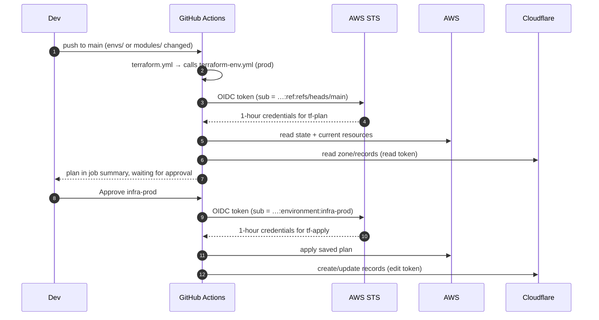
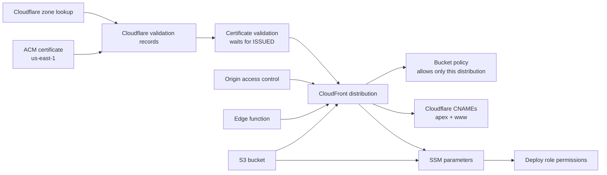

# Technical Deep Dive: GitHub Actions, Terraform and Multi-Provider Automation

This document explains, in depth:
1. **GitHub Actions**: how the pipelines are written, which steps were manual, and how they run.
2. **Terraform**: the concepts and how this project applies them.
3. **Providers**: how one Terraform configuration manages AWS, Cloudflare DNS and GitHub together.

---

# Part 1: GitHub Actions

## 1.1 Concepts used

| Concept | Meaning | Used here for |
|---|---|---|
| **Workflow** | A YAML file in `.github/workflows/` describing an automated process | `deploy.yml`, `terraform.yml`, `terraform-env.yml` |
| **Trigger (`on:`)** | The events that start a workflow | push, pull request, manual button, call from another workflow |
| **Job** | A group of steps on a fresh virtual machine (runner) | `deploy`, `plan`, `apply` |
| **Step** | One command or one reusable action | checkout, AWS sign-in, `terraform plan` … |
| **Action** | A published, reusable step | `actions/checkout`, `hashicorp/setup-terraform`, `aws-actions/configure-aws-credentials`, `actions/upload-artifact`, `actions/download-artifact` |
| **Environment** | A named deployment target with protection rules, its own variables and its own secrets | `infra-prod` (approval gate), `production` (website) |
| **Variables (`vars.*`)** | Non-secret configuration, at repository or environment level | Role ARNs, region, bucket name |
| **Secrets (`secrets.*`)** | Encrypted credentials, masked in logs | Cloudflare API tokens only |
| **OIDC token** | A signed identity document GitHub issues to a job, describing the repo, branch, event and environment | Exchanged for temporary AWS credentials |
| **Reusable workflow** | A workflow triggered by `workflow_call` and invoked by other workflows | Per-environment plan/apply logic |
| **Artifact** | A file passed between jobs | The saved Terraform plan |
| **Job summary** | Markdown rendered on the run page | Shows the plan and the outputs |

### Variable and secret scoping (an important detail)
| Level | Visible to |
|---|---|
| Repository variable / secret | Every job in the repository |
| Environment variable / secret | Only jobs that declare `environment: <name>`. These override repository values with the same name. |

This project relies on that scoping:
- **plan** has no environment, so it sees the repository secret `CLOUDFLARE_API_TOKEN`, which is the *read* token.
- **apply** runs in `infra-prod`, so the environment secret with the **same name** overrides it with the *edit* token.

The same workflow code therefore gets read access when planning and write access only after approval.

## 1.2 Workflow 1: `my-website/.github/workflows/deploy.yml`

**Purpose:** publish the website content.

| Section | What it does | Why |
|---|---|---|
| `on: push: branches: [main]` + `workflow_dispatch` | Runs on every push to `main`, or manually | Continuous delivery of content |
| `permissions: id-token: write, contents: read` | Allows the job to request a GitHub OIDC token; the repo is read-only | Required for password-less AWS sign-in |
| `concurrency: deploy-production` | Two deploys never run at the same time | Avoids overlapping syncs |
| `environment: production` | Runs in the `production` environment | Unlocks that environment's variables. The OIDC identity becomes `…:environment:production`, which the deploy role requires. |
| **Configure AWS credentials** | Exchanges the OIDC token for one-hour credentials for `vars.AWS_ROLE_ARN` | No stored keys |
| **Read deployment targets** | `aws ssm get-parameter` for `site_bucket` and `cloudfront_distribution_id` under `vars.SITE_PARAMETER_PREFIX` | Targets come from Terraform, not from hand-copied settings |
| **Sync files to S3** | `aws s3 sync . s3://<bucket> --delete`, excluding `.git`, `.github`, `.gitignore`, `.claude` and `*.md` | Uploads changed files and removes deleted ones. Documentation is never published. |
| **Invalidate CloudFront cache** | `create-invalidation --paths "/*"` | Visitors get the new version immediately |

## 1.3 Workflow 2: `my-website-infra/.github/workflows/terraform.yml` (entry point)

**Purpose:** decide *when* infrastructure runs and *for which environments*.

| Section | What it does |
|---|---|
| `on: pull_request` / `push: branches: [main]` with `paths: envs/**, modules/**, .github/workflows/terraform*.yml` | Runs only when infrastructure code changes. Edits to docs or bootstrap don't trigger it. |
| `workflow_dispatch` | Manual **Run workflow** button |
| `permissions: id-token: write, contents: read` | Granted here and passed down to the called workflow |
| `jobs: prod: uses: ./.github/workflows/terraform-env.yml, with: environment: prod, secrets: inherit` | Calls the reusable workflow for `prod` and passes the repository's secrets through |

Adding an environment means adding another three-line job (`dev:` …) here.

## 1.4 Workflow 3: `my-website-infra/.github/workflows/terraform-env.yml` (reusable)

**Purpose:** plan → (approve) → apply for one environment folder, `envs/<environment>`.

### Job `plan`
| Step | Detail |
|---|---|
| Checkout | Fetches the repository |
| Setup Terraform | Installs the latest Terraform 1.13.x. The wrapper is disabled so exit codes pass through unchanged. |
| AWS sign-in | Assumes `vars.TF_PLAN_ROLE_ARN` (read-only) |
| `terraform fmt -check -recursive` | Fails if any file isn't in canonical format |
| `terraform init` | Downloads the providers pinned in `.terraform.lock.hcl` and connects to the state. Settings come from `backend.hcl`; bucket and region come from `vars.TF_STATE_BUCKET` / `vars.AWS_REGION`. |
| `terraform validate` | Checks syntax and references |
| `terraform plan -detailed-exitcode -out=tfplan` | Exit code 0 means no changes, 2 means changes, 1 means error. The result becomes the job output `has_changes`. |
| Plan summary | `terraform show tfplan` is written to the run page |
| Upload plan | On `main` with changes only: uploads `tfplan` and the lock file as an artifact kept for one day |

### Job `apply`
| Setting / Step | Detail |
|---|---|
| `needs: plan` + `if: main && has_changes` | Runs only after a successful plan that has changes, on `main` |
| `environment: infra-<env>` | **Pauses until the required reviewer approves.** Also unlocks the edit-level Cloudflare token, and gives the OIDC identity `…:environment:infra-prod`, which the apply role requires. |
| `concurrency: terraform-apply-<env>` | Never two applies to the same environment at once. A running apply is never cancelled. |
| AWS sign-in | Assumes `vars.TF_APPLY_ROLE_ARN` |
| Download artifact | Retrieves the exact plan that was reviewed |
| `terraform init` | As in plan |
| `terraform apply tfplan` | Applies **that saved plan**. If the infrastructure changed after the plan, Terraform refuses, so what is applied is always what was reviewed. |
| Outputs | Writes the site URL and IDs to the run summary |

## 1.5 How a run proceeds end to end



## 1.6 Manual steps that were carried out

| # | Step | Where | Why it can't be automated |
|---|---|---|---|
| 1 | Prepared an admin workstation: a GCP VM with Terraform, AWS CLI and Git; connected Git to GitHub with an SSH key | GCP | Something has to run the first Terraform |
| 2 | Signed in to AWS with administrator access | AWS | Bootstrap creates the roles that later replace this access |
| 3 | Created a fine-grained GitHub token (Administration, Environments and Variables read/write) | GitHub | Bootstrap needs it to create environments and variables |
| 4 | Created two Cloudflare API tokens scoped to `tecssol.uk`: *Zone Read + DNS Read* and *Zone Read + DNS Edit* | Cloudflare | Credentials are issued by a human |
| 5 | Removed existing apex/`www` address records | Cloudflare | Terraform takes ownership of those names |
| 6 | Ran `terraform init / plan / apply` in `bootstrap/` | Admin VM | The chicken-and-egg step |
| 7 | Added the Cloudflare tokens as secrets: read token as repository secret, edit token as `infra-prod` environment secret | GitHub | Secret values are deliberately kept out of Terraform state |
| 8 | Started the Terraform workflow and **approved** the apply | GitHub | The approval gate is human by design |
| 9 | Pushed the website repository | GitHub | First content publish |

On an ongoing basis the only manual actions are **approving infrastructure applies** and **rotating tokens** before they expire.

## 1.7 Troubleshooting reference

| Symptom | Cause | Fix |
|---|---|---|
| `Input required and not supplied: aws-region` | The variable is missing, saved as a *secret*, or defined only in an environment the job doesn't use | Repository *variables*, which bootstrap writes |
| `Not authorized to perform sts:AssumeRoleWithWebIdentity` | The OIDC `sub` claim doesn't match the role's trust | Compare the trust with `terraform output github_oidc_subjects`. Decode the job's token claims to see the actual `sub`. |
| Workflow didn't start | The push touched no file matching `paths:` | Use **Run workflow** |
| Apply ran without waiting | The `infra-prod` environment has no reviewer (e.g. private repo on the free plan) | Re-apply bootstrap with `require_apply_approval = true` on a supported plan |

**About GitHub's subject format.** GitHub now sends subjects that include immutable IDs, for example `repo:<owner>@<owner-id>/<repo>@<repo-id>:ref:refs/heads/main`. Bootstrap looks up these IDs and trusts **both** that form and the classic `repo:<owner>/<repo>:…` form.

---

# Part 2: Terraform

## 2.1 Core concepts as used in this project

| Concept | Meaning | In this project |
|---|---|---|
| **Provider** | Plugin that talks to one platform's API | `hashicorp/aws ~> 6.0`, `cloudflare/cloudflare ~> 5.0`, `integrations/github ~> 6.0` |
| **Resource** | Something Terraform creates and owns | A bucket, a distribution, a DNS record, a GitHub environment |
| **Data source** | Something Terraform only *reads* | Account ID, GitHub repo IDs, Cloudflare zone, AWS-managed policies, the deploy role |
| **Variable** | An input | `aws_region`, `domain_name`, `environments` … |
| **`terraform.tfvars`** | Values for the variables, loaded automatically | One per root (bootstrap, envs/prod) |
| **Local** | A computed value reused inside the configuration | Bucket names, OIDC subjects, domain aliases |
| **Output** | A value printed after apply | Site URL, role ARNs, trusted subjects |
| **Module** | A reusable folder of configuration | `modules/static-site` |
| **Root module** | A folder you run Terraform in | `bootstrap/`, `envs/prod/` |
| **State** | Terraform's record mapping configuration to real objects | Local for bootstrap; S3 for each environment |
| **Backend** | Where state is stored | S3, with `use_lockfile` (native locking, no DynamoDB) |
| **Lock file** (`.terraform.lock.hcl`) | Pins exact provider versions and checksums for every platform | Committed; CI and the VM use identical providers |
| **Plan / Apply** | Preview changes, then make them | Saved plan file applied after approval |
| **`count` / `for_each`** | Create zero, one or many copies of a resource | Custom domain on/off; one deploy role per environment; one DNS record per alias |
| **`depends_on`** | An explicit ordering when there's no data reference | Certificate validation waits for the Cloudflare records |
| **`lifecycle`** | Special rules | `prevent_destroy` on the state bucket; `create_before_destroy` on the certificate |

## 2.2 Repository structure

```
my-website-infra/
├── bootstrap/                 # root module 1 (admin, local state)
│   ├── versions.tf            # Terraform & provider versions, provider config
│   ├── variables.tf           # inputs (all required except safe defaults)
│   ├── terraform.tfvars       # the values
│   ├── state.tf               # state bucket + protections
│   ├── github_lookup.tf       # GitHub user/repo ID lookups → OIDC subjects
│   ├── iam_ci.tf              # OIDC provider, tf-plan and tf-apply roles
│   ├── iam_deploy.tf          # per-environment website deploy roles (trust only)
│   ├── github_config.tf       # GitHub environments, branch rules, variables
│   └── outputs.tf
├── modules/static-site/       # reusable module (no environment values)
│   ├── versions.tf            # required providers incl. aws.us_east_1 alias
│   ├── variables.tf / main.tf / outputs.tf
│   ├── s3.tf                  # private bucket + policy
│   ├── cloudfront.tf          # OAC, edge function, distribution
│   ├── dns.tf                 # ACM certificate + Cloudflare records
│   └── deploy.tf              # SSM parameters + deploy role permissions
└── envs/prod/                 # root module 2 (CI, S3 state)
    ├── versions.tf            # providers + empty s3 backend block
    ├── backend.hcl            # state key, encryption, locking
    ├── variables.tf / terraform.tfvars
    ├── main.tf                # module "site" { … }
    └── outputs.tf
```

## 2.3 State management
- **Bootstrap** keeps local state on the admin workstation, because the state bucket doesn't exist until bootstrap creates it. It can be moved into the bucket later with `terraform init -migrate-state`.
- **Environments** use a *partial* S3 backend configuration. The committed `backend.hcl` holds the key `envs/prod/terraform.tfstate`, `encrypt` and `use_lockfile`. The bucket and region are passed at `init` time from GitHub variables, so the account-specific bucket name is never committed.
- **Locking:** `use_lockfile = true` writes a `.tflock` object next to the state, so two runs cannot modify it at once. The plan role may write and delete only `*.tflock` objects.

## 2.4 The dependency graph of a production apply
Terraform works out the order from references between resources:



---

# Part 3: Managing AWS, Cloudflare and GitHub from one configuration

## 3.1 The principle
Terraform core doesn't know about any particular platform. Each **provider** translates resources into that platform's API calls. Anything with an API and a provider can be managed the same way: plan, review, apply, state.

```
.tf files ─► Terraform core (graph, plan, state) ─► provider plugins ─► platform APIs
                                                     ├ hashicorp/aws        ─► AWS APIs
                                                     ├ cloudflare/cloudflare ─► api.cloudflare.com
                                                     └ integrations/github  ─► api.github.com
```

## 3.2 Declaring and pinning providers
Each root module declares its providers in a `required_providers` block, giving the source and allowed versions:
- `hashicorp/aws` `~> 6.0` (any 6.x)
- `cloudflare/cloudflare` `~> 5.0`
- `integrations/github` `~> 6.0`

`terraform init` downloads them. The lock file records the exact version and checksums, so every machine uses identical binaries.

## 3.3 Provider configuration and authentication

| Provider | Configured in | How it authenticates | Notes |
|---|---|---|---|
| **AWS** (default) | `bootstrap/versions.tf`, `envs/prod/versions.tf` | Standard AWS credential chain. On the VM: the admin's SSO/CLI login. In CI: the temporary credentials from `configure-aws-credentials` (OIDC). | `region = var.aws_region`. `default_tags` labels every resource with Project / Environment / ManagedBy. |
| **AWS** alias `us_east_1` | `envs/prod/versions.tf` | Same credentials | A second instance of the same provider for N. Virginia, because CloudFront only accepts certificates from there |
| **Cloudflare** | `envs/prod/versions.tf` (`provider "cloudflare" {}`) | The `CLOUDFLARE_API_TOKEN` environment variable: a read token in plan, an edit token in apply | Nothing secret in code. The token scope (one zone) limits what it can touch. |
| **GitHub** | `bootstrap/versions.tf` (`owner = var.github_owner`) | The `GITHUB_TOKEN` environment variable on the admin VM | Used only in bootstrap, never in CI |

**Why tokens come from environment variables:** provider blocks contain no credentials. Nothing secret is committed, and the same code runs locally and in CI with different credentials.

## 3.4 Passing providers into a module
The module declares that it needs `aws`, an extra `aws.us_east_1` (`configuration_aliases`), and `cloudflare`. The environment passes its configured providers in explicitly:

```hcl
module "site" {
  source    = "../../modules/static-site"
  providers = {
    aws           = aws
    aws.us_east_1 = aws.us_east_1
    cloudflare    = cloudflare
  }
  ...
}
```
Inside the module, the certificate resources select `provider = aws.us_east_1`. Everything else uses the default AWS provider (Mumbai).

## 3.5 How each platform is managed

### AWS
- **Resources:** S3 buckets and their settings, CloudFront OAC, function and distribution, ACM certificate and validation, IAM roles and inline policies, OIDC provider, SSM parameters.
- **Data sources:** caller identity (account ID), managed cache and header policies, the deploy role.
- **IAM policies** are built with `aws_iam_policy_document` data sources rather than hand-written JSON. They are validated and composable (the apply policy includes the plan policy through `source_policy_documents`).

### Cloudflare DNS
1. `data "cloudflare_zone"` finds the zone by name (`tecssol.uk`), so no zone ID is copied by hand.
2. AWS creates the certificate and *returns* the validation records it expects (`domain_validation_options`).
3. `cloudflare_dns_record` creates one record for each of those values (`for_each`). Trailing dots are trimmed, `proxied = false`, TTL automatic.
4. `aws_acm_certificate_validation` waits until AWS sees the records and issues the certificate.
5. After the distribution exists, two more `cloudflare_dns_record` resources point `tecssol.uk` and `www` to it. Cloudflare's CNAME flattening makes the apex record valid.

Values flow **from one provider into another**: the AWS output becomes the Cloudflare input, and the Cloudflare result unblocks the next AWS step. Terraform orders all of this from the references.

### GitHub
- **Data sources:** `github_user` (owner's numeric ID) and `github_repository` (each repo's numeric ID). These build the exact OIDC subjects for the AWS trust policies, which is another cross-provider flow (GitHub → AWS).
- **Resources:**
  - `github_repository_environment`: `infra-prod` with an optional required reviewer, and `production`. Both use custom branch policies.
  - `github_repository_environment_deployment_policy`: restricts each environment to `main`.
  - `github_actions_variable`: infra repository variables (state bucket, role ARNs, region).
  - `github_actions_environment_variable`: website `production` variables (deploy role ARN, region, parameter prefix).
- Values flow **AWS → GitHub**: the role ARNs and bucket name Terraform just created become GitHub variables in the same apply.
- **Not managed by Terraform:** the workflow YAML files (ordinary code in the repo) and secret values (kept out of state on purpose).

## 3.6 Why credentials are split across layers

| Layer | AWS access | Cloudflare | GitHub |
|---|---|---|---|
| Bootstrap (admin VM) | Administrator (temporary sign-in) | — | Fine-grained admin token |
| Plan (CI) | Read-only role | DNS read token | Built-in workflow token (checkout only) |
| Apply (CI, approved) | Scoped change role | DNS edit token | Built-in workflow token (checkout only) |
| Website deploy (CI) | One bucket + one distribution | — | Built-in workflow token (checkout only) |

Each layer holds only what its job requires. The most powerful credentials are used rarely, by a person, and never live in CI.
