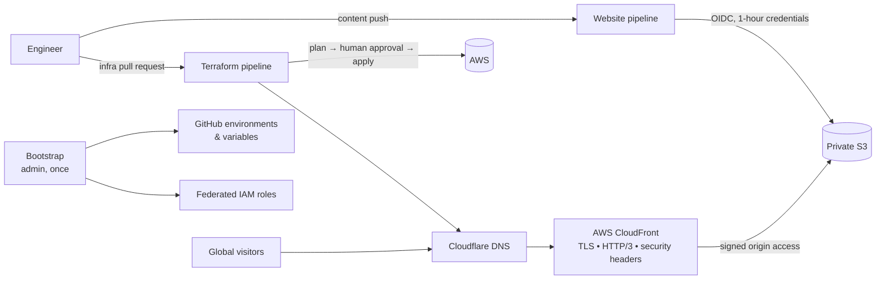

# Case Study: tecssol.uk
### A zero-credential, fully automated, multi-provider cloud delivery platform for a technical publication

| | |
|---|---|
| **Live** | https://tecssol.uk |
| **Role** | Cloud / DevOps engineer: architecture, infrastructure as code, CI/CD, security |
| **Platforms** | AWS · Cloudflare · GitHub Actions · Terraform · Google Cloud (admin workstation) |
| **Date** | November 2026 |

---

## Executive summary

I designed and delivered the platform behind **tecssol.uk**, a technical blog and portfolio. It is served worldwide through a CDN from private cloud storage, on a custom domain with automatically managed HTTPS.

The goal was not just to put a website online. It was to run it **the way production systems are run in well-governed enterprises**:
- every piece of infrastructure is defined in code;
- every change is reviewed before it happens;
- no long-lived passwords or access keys exist anywhere in the delivery pipeline.

One Terraform codebase manages resources across **three independent platforms**: AWS for hosting and security, Cloudflare for DNS, and GitHub for deployment governance. Two separate pipelines keep content changes and infrastructure changes apart.

**Outcome:** a publish is one `git push`. An infrastructure change is one reviewed pull request and one approval. Recreating the entire platform from scratch is one bootstrap run plus one pipeline run.

---

## 1. The challenge

A static website is simple to host. Hosting it to an enterprise standard raises real engineering questions:

| Question | Typical shortcut | Risk of the shortcut |
|---|---|---|
| How does CI get cloud access? | Paste an access key into CI secrets | Leaked keys are one of the most common causes of cloud breaches |
| How is infrastructure created? | Click through consoles | Undocumented, unrepeatable, drifts over time |
| How are changes controlled? | Apply directly | No review, no audit trail, no rollback |
| How do separate platforms connect? | Copy IDs between dashboards | Manual errors, stale configuration |
| What if the domain's DNS isn't in the cloud provider? | Migrate the DNS | Not always possible; the domain here is registered with Cloudflare, which keeps its DNS on Cloudflare |

**Objective:** a platform where all four risks are designed out, built so it can grow from one environment to many without rework.

---

## 2. The solution

### Key capabilities
- **Global, secure delivery:**
  - CloudFront serves the site from edge locations across North America, Europe, Asia (including India), the Middle East and Africa;
  - HTTPS enforced, HTTP/2 and HTTP/3, IPv6, compression, managed security headers;
  - the storage bucket is completely private, readable only by this one CDN distribution.
- **Infrastructure as code across three providers:**
  - AWS resources, Cloudflare DNS records and GitHub repository governance are all declared in Terraform;
  - outputs from one platform feed the next automatically: AWS certificate challenges become Cloudflare records, and AWS role identifiers become GitHub variables.
- **Password-less CI/CD:**
  - GitHub Actions signs in to AWS through OpenID Connect federation, with credentials that expire in one hour;
  - each pipeline context (PR, main, approved apply, website publish) maps to its own least-privilege role.
- **Governed change management:**
  - every infrastructure change appears as a plan on the pull request;
  - after merge, the plan is saved, a human approves it, and **exactly that plan** is applied.
- **Environment-ready structure:**
  - a reusable module plus per-environment configuration;
  - adding `dev` or `staging` is a folder copy and a three-line pipeline change.

---

## 3. Key engineering decisions

| Decision | Alternatives considered | Rationale |
|---|---|---|
| **OIDC federation instead of access keys** | Static IAM user keys in GitHub secrets | Removes the most common cloud credential-leak vector. Access is time-boxed and tied to repo, branch and environment. |
| **Trust bound to immutable GitHub IDs**, looked up via the GitHub API | Hand-typed repository names | A deleted and re-created repository with the same name can't impersonate this one. No IDs hard-coded. |
| **Three-layer Terraform design**: bootstrap / reusable module / environment | One flat configuration | CI can't change its own permissions. The module is reusable. Each environment has isolated state and approval. |
| **Separate plan and apply roles** | One CI role | Pull requests get read-only access. Write access exists only behind a human approval. |
| **Apply the saved, reviewed plan** | Re-plan at apply time | What is approved is exactly what runs; Terraform refuses if reality changed in between. |
| **Cloudflare provider for DNS** | Moving DNS to Route 53 | The registrar requires Cloudflare DNS. Integrating the existing platform beats forcing a migration. |
| **Parameter Store hand-off to the website pipeline** | Copying bucket and CDN IDs into GitHub secrets | The website repository holds **zero secrets**. The infrastructure publishes its own coordinates. |
| **Terraform writes GitHub settings**, but humans hold secret values | Managing tokens in Terraform | Configuration is automated. Secret values stay out of Terraform state. |
| **Private S3 + Origin Access Control** | Public S3 website hosting | No public storage endpoint. HTTPS everywhere. Only the CDN can read the content. |
| **S3 native state locking** | DynamoDB lock table | Simpler and cheaper with current Terraform; one less resource to secure. |

---

## 4. Challenges and how they were solved

**1. Federated sign-in rejected despite a correct-looking trust policy**
- **Symptom:** the pipeline failed with `Not authorized to perform sts:AssumeRoleWithWebIdentity`, while the AWS trust policy appeared correct.
- **Diagnosis:** I decoded the claims of the job's own OIDC token inside the pipeline. GitHub was issuing an **ID-qualified subject** (`repo:owner@<id>/repo@<id>:…`), not the classic name-only format the trust policy expected.
- **Fix:** I replaced hand-written subjects with **live lookups** of the account and repository IDs through Terraform's GitHub provider. The trust policy now accepts both the current and the classic format, exactly. It is more secure (immutable IDs) and resilient to future format changes.

**2. A domain whose DNS can't move**
- The domain is registered with Cloudflare, which keeps its DNS on Cloudflare, so the standard AWS approach (Route 53 DNS validation) wasn't possible.
- I connected the Cloudflare provider. AWS certificate validation challenges are written to Cloudflare automatically, and the domain records point to CloudFront using Cloudflare's apex CNAME flattening.

**3. Configuration drift between dashboards**
- An early iteration needed values copied manually into GitHub, which caused variable-scope mistakes (repository vs environment, variables vs secrets).
- I made Terraform the single writer of all non-secret GitHub configuration: environments, branch policies, approval rules and variables. That class of error is now gone.

**4. Least privilege without blocking automation**
- The apply role must manage IAM permissions for the deploy role, but must not be able to escalate itself.
- Bootstrap creates the deploy role. The CI apply role can only *attach permissions to that specific role*: it cannot create roles, and it cannot modify the CI roles or the state bucket's protections.

---

## 5. Outcomes

| Area | Result |
|---|---|
| **Security** | Zero long-lived cloud credentials in CI. Website repository holds zero secrets. Private origin. HTTPS-only. Every role scoped to one repository and context. |
| **Governance** | 100% of infrastructure in version control. Every change previewed, approved by a human and recorded in Git and pipeline history. |
| **Speed** | Content publishes on `git push` in about a minute. Infrastructure changes are a pull request and one click. |
| **Repeatability** | The full platform (about 40 managed resources across three providers) can be rebuilt from the repositories. |
| **Scalability of design** | New environments need configuration only, no new code. The site module is reusable for other sites. |
| **Operating cost** | Serverless, pay-per-use services; no servers to patch or run. |

---

## 6. Skills demonstrated

| Domain | Evidence in this project |
|---|---|
| **Cloud architecture (AWS)** | S3, CloudFront (OAC, Functions, managed policies), ACM, IAM, STS federation, SSM Parameter Store, multi-region provider design |
| **Infrastructure as code** | Terraform modules, multi-provider graphs, remote state with locking, partial backends, lock files, `for_each`/`count`, provider aliases, policy documents |
| **CI/CD engineering** | GitHub Actions reusable workflows, environments and protection rules, OIDC, saved-plan artifacts, concurrency control, path-filtered triggers |
| **Security engineering** | Zero-trust federation, least privilege, separation of duties, privilege-escalation prevention, secret minimisation |
| **Multi-cloud / multi-vendor** | AWS + Cloudflare + GitHub managed together; administered from Google Cloud |
| **Troubleshooting** | Root-caused an identity federation failure by inspecting token claims, and turned the fix into a more secure design |
| **Communication** | Layered documentation for engineers, operators and non-technical stakeholders |

---

## 7. What's next

- **Environments:** add `dev` with its own approval policy, using the existing module and reusable pipeline.
- **Edge security:** add AWS WAF or Cloudflare security rules, and CloudFront access logging with alerting.
- **Quality gates:** link checking and HTML validation in the website pipeline; policy-as-code (e.g. Checkov / OPA) in the Terraform pipeline.
- **Observability and cost:** CloudWatch dashboards and AWS Budgets alerts.
- **Bootstrap maturity:** migrate bootstrap state to the remote backend, and replace the personal GitHub token with a GitHub App.

---

*Repositories: `my-website` (content and deploy pipeline) and `my-website-infra` (Terraform and infrastructure pipeline). Detailed design notes are in the `docs/` folder of each.*
