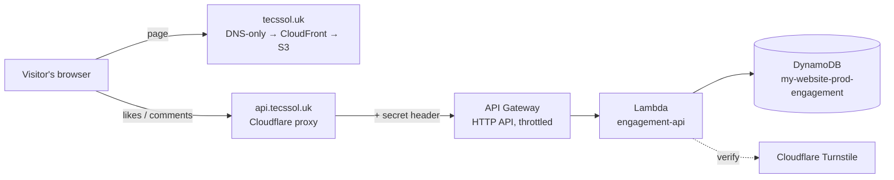

# Likes, Comments and Visitor Analytics

*How the blog's likes and comments work, how to roll them out, and how to look after them.*

---

## 1. What was added



| Piece | Where | Purpose |
|---|---|---|
| `modules/engagement-api` | infra repo | DynamoDB table, Lambda, HTTP API, `api.tecssol.uk` certificate and domain, Cloudflare rules, cost budget |
| Turnstile widget | Cloudflare dashboard (by hand) | Bot check for likes and comments. Its API permission is not offered for these tokens, so Terraform only receives its keys |
| `bootstrap/iam_engagement.tf` | infra repo | The Lambda's execution role (CI cannot create IAM roles) |
| `bootstrap/iam_ci.tf` | infra repo | Lets the plan/apply roles read/manage the new services, limited to `my-website-*` names |
| `assets/engagement.js`, `.css` | website repo | Like button, share, comment list and form |
| `assets/site.js` | website repo | Loads Cloudflare Web Analytics on every page |
| `deploy.yml` → *Write site config* | website repo | Writes `assets/site-config.js` from SSM: API address, Turnstile site key, analytics token |

### Bot and cost protection, outermost first
1. **Cloudflare firewall** (free): only `GET`/`POST`/`OPTIONS`, only `/v1/posts/...` paths.
2. **Cloudflare rate limit** (free): more than 20 requests in 10 s from one IP is blocked for 10 s.
3. **Turnstile**: every like and comment needs a fresh bot-check token, verified by the Lambda.
4. **Secret header**: Cloudflare adds `x-origin-verify`; the Lambda rejects requests without it, so going around Cloudflare to AWS fails. The default `execute-api` address is disabled.
5. **API Gateway throttling**: 10 requests/second (burst 20) for the whole API, a hard ceiling on cost.
6. **AWS Budget**: email at 80 % of $5 actual spend, and when the month is forecast to exceed $5.

Likes are counted once per visitor per post. The visitor is identified by a keyed hash of their IP; **IP addresses are never stored**.

---

## 2. Cloudflare API tokens

The two existing tokens only have DNS permissions. **Edit** both in the dashboard (*My Profile → API Tokens → ⋯ → Edit*). Editing keeps the token value, so the GitHub secrets do not change.

### Plan token (repository secret `CLOUDFLARE_API_TOKEN`, read-only)

| Scope | Permission | Resource |
|---|---|---|
| Zone | Zone : Read | `tecssol.uk` |
| Zone | DNS : Read | `tecssol.uk` |
| Zone | Zone WAF : Read | `tecssol.uk` |
| Zone | Transform Rules : Read | `tecssol.uk` |
| Zone | Config Rules : Read | `tecssol.uk` |

### Apply token (environment secret on `infra-prod`)

| Scope | Permission | Resource |
|---|---|---|
| Zone | Zone : Read | `tecssol.uk` |
| Zone | DNS : Edit | `tecssol.uk` |
| Zone | Zone WAF : Edit | `tecssol.uk` |
| Zone | Transform Rules : Edit | `tecssol.uk` |
| Zone | Config Rules : Edit | `tecssol.uk` |

No account-level permissions are needed. Cloudflare's own naming varies between pages (e.g. *Config Settings*). Pick the matching entry in the dropdown. If apply fails with `403` on the firewall or rate-limit ruleset, also add **Firewall Services : Edit** (and **Read** on the plan token).

**Set up by hand** (their API permissions are account-wide or not offered for these tokens):
- **Turnstile widget**: *Turnstile → Add widget*. Name `my-website-prod`, hostnames `tecssol.uk` and `www.tecssol.uk`, mode **Managed**, pre-clearance **No**.
  - **Site Key** (public) → `turnstile_site_key` in `envs/prod/terraform.tfvars`.
  - **Secret Key** → GitHub, infra repo, *Settings → Secrets and variables → Actions → New repository secret*, name `TURNSTILE_SECRET_KEY`. Only the plan job reads it; apply reuses the saved plan. It ends up only in the Lambda's settings and the encrypted state.
  - To rotate it: *Rotate secret* in the dashboard, update the GitHub secret, then re-run the infra workflow.
- **Web Analytics**: its API needs the account-wide *Account Settings : Edit* permission, which is far too broad for a CI token.

---

## 3. Rollout order

| # | Step | Who / where | Notes |
|---|---|---|---|
| 0 | Check Cloudflare for existing rules | Dashboard | *Security → WAF → Custom rules* and *Rate limiting rules*; *Rules → Transform Rules (Request Header)*; *Rules → Configuration Rules*. Terraform will own these lists for the zone. If any rules exist, delete them or recreate them in `cloudflare.tf`. |
| 1 | **`terraform apply` in `bootstrap/`** | You, on the admin machine | Creates the Lambda role and widens the CI roles. **Must be done before step 4**, or CI fails with *AccessDenied* or *role not found*. |
| 2 | Edit both Cloudflare tokens, create the Turnstile widget | Dashboard + GitHub | Section 2. Put the site key in `terraform.tfvars` and the secret key in the `TURNSTILE_SECRET_KEY` repository secret. |
| 3 | *(Optional)* Web Analytics | Dashboard | *Analytics & Logs → Web Analytics → Add a site* → `tecssol.uk` → choose the JS snippet. Copy the `token` value into `envs/prod/terraform.tfvars` as `web_analytics_token`. Skip it to add later. |
| 4 | **Infra PR → merge → approve apply** | GitHub | The PR shows the plan. After merge, the `apply (prod)` job waits for approval on `infra-prod`. This is the second and last apply. |
| 5 | Push the website repo | GitHub | `deploy.yml` writes `assets/site-config.js`. If the website was deployed before step 4, re-run *Deploy site* (*Actions → Run workflow*). |
| 6 | Check | Terminal | See below. |

Step 1 commands (same as the original bootstrap run):

```bash
cd bootstrap
export GITHUB_TOKEN=...            # same token as before
terraform init                     # add the -backend-config flags if you migrated state to S3
terraform plan                     # expect: 1 role added, 1 policy changed
terraform apply
```

Step 6 checks:

```bash
curl -s https://api.tecssol.uk/v1/posts/terraform    # → {"slug":"terraform","likes":0,"comments":[]}
curl -s -o /dev/null -w '%{http_code}\n' -X DELETE https://api.tecssol.uk/v1/posts/terraform   # → 403 (Cloudflare)
curl -s https://tecssol.uk/assets/site-config.js     # → apiBaseUrl and turnstileSiteKey filled in
```

---

## 4. Looking after comments

Table: `my-website-prod-engagement`, region `ap-south-1`. Post slugs: `static-website`, `terraform`, `auth0-to-cognito`.

**List a post's comments**
```bash
aws dynamodb query --region ap-south-1 --table-name my-website-prod-engagement \
  --key-condition-expression "pk = :p AND begins_with(sk, :c)" \
  --expression-attribute-values '{":p":{"S":"POST#terraform"},":c":{"S":"COMMENT#"}}' \
  --query 'Items[].{sk:sk.S,name:name.S,status:status.S,text:text.S}' --output table
```

**Delete a comment** (use the `sk` from the list)
```bash
aws dynamodb delete-item --region ap-south-1 --table-name my-website-prod-engagement \
  --key '{"pk":{"S":"POST#terraform"},"sk":{"S":"COMMENT#2026-11-20T10:00:00Z#a1b2c3d4e5f6"}}'
```

**Require approval before comments appear**: set `comments_require_approval = true` in `envs/prod/terraform.tfvars` and apply. New comments are then stored as `pending`. To approve one:
```bash
aws dynamodb update-item --region ap-south-1 --table-name my-website-prod-engagement \
  --key '{"pk":{"S":"POST#terraform"},"sk":{"S":"COMMENT#..."}}' \
  --update-expression "SET #s = :a" --expression-attribute-names '{"#s":"status"}' \
  --expression-attribute-values '{":a":{"S":"approved"}}'
```

**Add a new post**: no infra change. In the post's HTML, add the `engagement.css`/`site-config.js`/`site.js`/`engagement.js` tags in `<head>` (copy from an existing post) and
`<section class="engagement" data-engagement data-post="new-post-slug"></section>` before `</article>`. Slugs: lowercase letters, digits and hyphens.

---

## 5. Troubleshooting

| Symptom | Cause / fix |
|---|---|
| Apply: *a similar configuration with rules already exists* / entrypoint ruleset conflict | Rules for that phase already exist in the dashboard (step 0). Delete them and re-run apply. |
| Apply: `403` from Cloudflare | Token missing a permission (section 2). |
| Apply: `AccessDenied` on dynamodb / lambda / apigateway / budgets | Bootstrap was not re-applied (step 1). |
| Apply: *Caller does not have permissions to create a Service Linked Role* (API Gateway domain) | The account-wide `AWSServiceRoleForAPIGateway` role is created by bootstrap (`iam_engagement.tf`). Re-apply bootstrap, then re-run the infra workflow. |
| Plan: warning *failed to make http request for the dry run … 403* on rulesets | Expected. The provider's dry run is a write call, and the plan token is read-only. Harmless as long as the apply creates the rulesets. |
| Apply: `NoSuchFile ... engagement-api.zip` | The plan artifact did not include `.build/`. Re-run the whole workflow, not just the apply job. |
| Site: like/comment section only shows *Share* | `site-config.js` has empty values. Re-run *Deploy site* after the infra apply. |
| Plan: *turnstile_secret_key is empty* | The `TURNSTILE_SECRET_KEY` repository secret is missing. |
| Site: *Bot check failed* on every action | Turnstile widget hostnames must include `tecssol.uk` and `www.tecssol.uk`, and the GitHub secret must belong to the same widget as the site key. |
| API returns `525/526` | Cloudflare → API Gateway TLS. Check the *Configuration Rule* for `api.tecssol.uk` (Full strict) and the ACM certificate status. |
| `403 Forbidden` JSON from the API | The request did not come through Cloudflare (missing `x-origin-verify`). Check the Transform Rule exists. |

---

## 6. Cost

Expected **≈ $0/month** at blog traffic: Lambda and DynamoDB stay in their always-free tiers, and API Gateway costs about $1.10 per million requests. Cloudflare's firewall, rate limit, Turnstile and Web Analytics are free. The worst case is capped by API Gateway throttling, and the budget email warns at $4.
